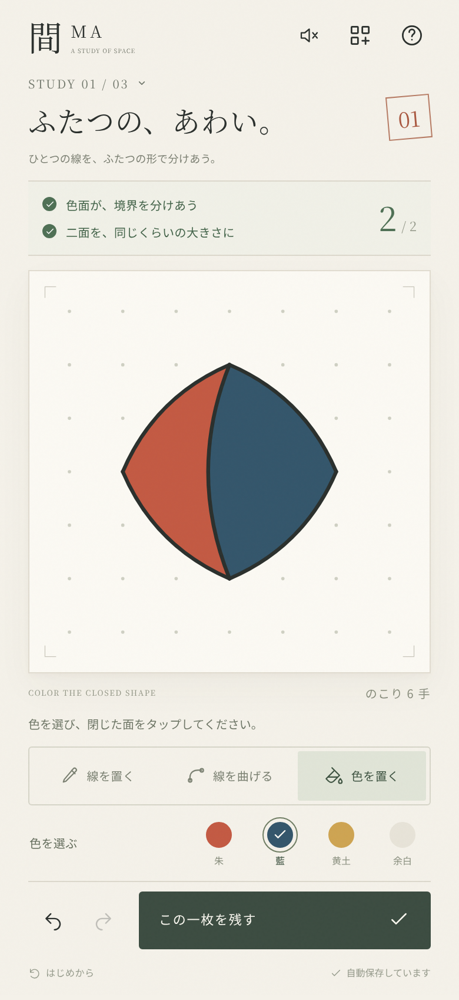

# 間 — MA

**線を置く。余白が、生まれる。**

スマートフォンの縦画面で、曲線と色面を組み合わせて自分の一枚を残す造形ゲーム。[設計研究](docs/design-research.md)をもとに、制作と判断の核を遊べる形にしました。



## 遊びかた

1. **線を置く**：紙の点を2つタップし、5段階のふくらみを試してから確定。
2. **色を置く**：線で輪を閉じたら、朱・藍・黄土から色を選んで面をタップ。
3. **線を曲げる**：既存の境界を選び、両側の形や余白を調整。
4. 2つの条件が成立したら、手数が残っていても**この一枚を残す**。

線を置く・曲げる・色を変える操作は各1手。取り消し／やり直しは回数制限がなく、手数や色も正確に戻ります。確定前の試行には手数を使いません。時間制限、美しさの採点、ランキングはありません。

### 3つの習作と自由制作

| 習作 | ためすこと | 成立条件 |
| --- | --- | --- |
| 01 ふたつの、あわい。 | 隣りあう | 色面が境界を共有し、面積比が1:2〜2:1の組がある |
| 02 余白の、通りみち。 | 離して置く | 上下に離れた色面があり、中央の帯に幅のある左右の余白が通る |
| 03 線は、意味を変える。 | つながり直す | 三色の面があり、ひとつの面がほかの二面と境界を共有する |
| 自由制作 | 好きなところで完成 | 課題・手数制限なし |

習作は各12手。任意の順番で遊べ、描きかけは習作ごとに保持されます。作品集の一枚から、元の作品を残して新しい自由制作を始められます。

### 保存とオフライン

- 描きかけ、履歴、作品集は端末の**このブラウザ**の `localStorage` に自動保存。アカウントやサーバーは不要です。
- PNG（1080 × 1230、作品名入り）／SVGで書き出せます。対応するスマートフォンでは共有シートを開きます。
- 本番ビルドをHTTPSで一度読み込み、オフライン用ファイルの保存が済むと、ネット接続なしで再開できます。開発サーバーではService Workerを登録しません。
- 対応ブラウザでは「ホーム画面に追加」して使えます。iOSの場合はSafariの共有メニューから追加します。
- ブラウザのサイトデータを削除すると制作記録も消えます。大切な作品は画像でも保存してください。端末間の同期・クラウド保存はありません。

## 開発

Node.js **24.19.0** で検証。Node.js 22.12以上が必要です。

```sh
npm ci
npm run dev
```

Viteの開発サーバーはポート5173。スマートフォンで試す場合は、同じネットワークから開発マシンのアドレスへ接続してください。PWA・共有機能にはHTTPSなどのセキュアコンテキストが必要です。

```sh
npm test          # 図形、判定、履歴、保存形式のテスト
npm run build    # TypeScriptチェック、本番ビルド、オフラインキャッシュ生成
npm run preview  # ビルド結果をポート4173で確認
npm run test:e2e # 390×844 / 320×667 のタッチ操作とデスクトップのブラウザテスト
```

ブラウザテストは `/usr/bin/chromium` があれば使います。それ以外の環境では `npx playwright install chromium`、または `PLAYWRIGHT_CHROMIUM_EXECUTABLE` で実行ファイルを指定してください。`npm run check` で全チェックを実行します。外部API、DB、秘密鍵、環境変数は不要です。

## 配信

`npm run build` でできる **`dist/` 全体**を、HTTPS対応の静的ホスティングに配置します。相対パスのため、ルートと `/ma/` のようなサブディレクトリの両方に対応します。

GitHub ActionsのCIはテストを行い、配信用 `ma-web` アーティファクトと画面の検証結果を保存します。**Deploy to GitHub Pages** は `main` への更新で自動実行され、手動実行にも対応します。初回はGitHubの Settings → Pages の Source を **GitHub Actions** に設定してください。Pagesの初回有効化には、連携アプリのコード更新権限とは別の権限が必要です。非公開リポジトリではGitHubの契約プランによる制限もあります。

## 実装

TypeScript + Vite + SVG。ゲーム本体に実行時の外部ライブラリ、外部フォント、画像配信、トラッキングはありません。図版とアイコンはSVGで作成しています。

- `src/geometry.ts` — 二次ベジェ曲線、端点の吸着、線の分割、半辺による閉領域の探索、入れ子の穴、面積、余白の通路。
- `src/model.ts` — 習作、12手の制限、無料の取り消し／やり直し、局所的な色の継承、保存形式。
- `src/main.ts` / `src/style.css` — 縦画面の操作、制作道具、案内、作品集。
- `src/art.ts` — 作品のSVG描画と画像書き出し。
- `scripts/build-sw.mjs` — ビルドごとに資材のハッシュからオフラインキャッシュを生成。

### 判定の範囲

紙の枠は閉領域の境界にはなりません。実際に接続された線の輪だけを面にします。交差点を端点として指定した接続は可能ですが、途中の線を無指定に横切る操作は確定できません。線上を端点に選ぶと、元のベジェ曲線の形を保って分割します。

課題で数える色面は論理座標で面積1000以上。曲線の面積は40分割による近似です。余白の通路は論理座標360×360の中央帯（y=84〜276）を6刻みで探索し、線から11以上の間隔を取ります。極細の隙間だけで条件が成立するのを防ぎます。これは美しさの評価ではなく、明示された関係の判定です。

意図的な覆い直し、全操作の再生、色混合、日替わり課題は今回の実装範囲には含めていません。実機での長時間の遊びやすさ・課題の難易度は、今後のプレイテストで調整できます。
